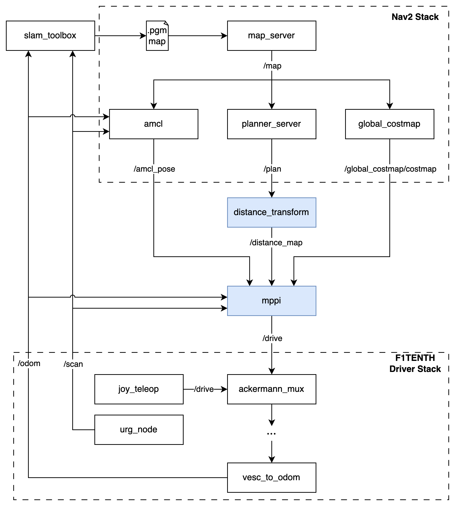
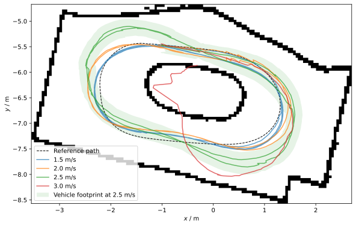
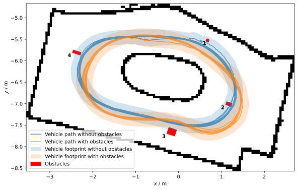
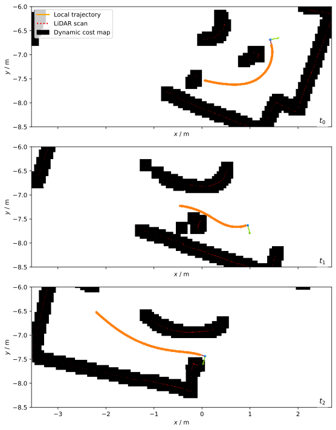
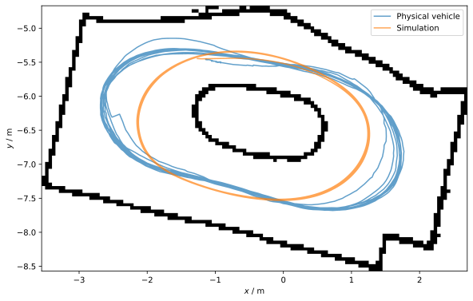

# F1TENTH MPPI

GPU-accelerated **Model Predictive Path Integral (MPPI)** control for a 1/10-scale
F1TENTH race car, developed for my master thesis at the Institute of Automotive
Engineering (IFS), University of Stuttgart.

The controller samples 2048 control sequences over a 64-step horizon (20 ms
steps, 1.28 s look-ahead) on the GPU, rolls them out through a kinematic
single-track model, and blends them with information-theoretic weighting. It
follows a global path, tracks a target velocity, penalizes lateral acceleration
and avoids obstacles detected by the LiDAR. It runs onboard the car's NVIDIA
Jetson and in the F1TENTH gym simulator.

The controller is built on [MPPI-Generic](https://github.com/kien-thanh/MPPI-Generic)
(included as a git submodule), a CUDA library for stochastic trajectory optimization.

## Repository layout

```
src/
├── mppi/                MPPI ROS 2 node (CUDA)
│   ├── include/mppi/    single-track dynamics, cost function, plant, GPU textures
│   └── src/             mppi_node.cu, dynamics/cost kernels, LiDAR scan processor
├── distance_transform/  turns the global path into distance and heading grids for the cost
├── path_augment/        converts a nav2 path into a vehicle-state trajectory
├── f1tenth_bringup/     launch files and parameters (MPPI, AMCL, EKF, nav2 planner, map)
├── interfaces/          DistanceMap message
├── particle_filter/     RangeLibc-based particle filter localization (team project)
├── safety_node/         emergency braking (team project)
└── vehicle_msgs/, vesc_msgs/
maps/                    occupancy maps of the lab tracks (pgm + yaml)
global_path*.yaml        pre-computed global paths for the lab track
.devcontainer/           CUDA + ROS 2 Humble dev container (Jetson and x86)
```

## How it works

| Component | Details |
|---|---|
| Dynamics | Kinematic single-track model, state `[x, y, δ, v, ψ]`, controls `[steering rate, acceleration]`, wheelbase 0.31 m |
| Sampling | Gaussian control perturbations, 2048 rollouts × 64 timesteps, λ = 1 |
| Cost | distance to the global path (`c_distance`), velocity tracking (`c_velocity`), heading alignment (`c_angle`), inflated costmap and LiDAR obstacles (`c_costmap`), lateral acceleration (`c_latacc`) |
| Latency compensation | the localization pose is extrapolated by `delay_constant + delay_factor · message age` before each optimization |
| Obstacles | the scan processor projects `/scan` into the map frame and writes it into a GPU texture each cycle |

### System architecture

The blue nodes are the ones developed in this work. Mapping, localization and global
planning come from Nav2 and slam_toolbox, and the hardware interface from the F1TENTH driver stack.

<p align="center"></p>

On the car, MPPI uses `/amcl_pose` and `/odom`. In simulation it uses `/ego_racecar/odom`.
Besides `/drive`, the node publishes `/local_trajectory` and `/debug/mppi_rollouts` for visualization.

### Parameters (`src/f1tenth_bringup/config/mppi_params.yml`)

| Parameter | Meaning |
|---|---|
| `desired_velocity`, `v_max` | target and maximum speed [m/s] |
| `c_distance`, `c_velocity`, `c_angle`, `c_costmap`, `c_latacc` | cost weights |
| `delay_constant`, `delay_factor` | latency compensation |
| `sim` | `true`: simulator odometry and laser frame; `false`: AMCL + VESC odometry on the car |
| `real_laser_frame`, `sim_laser_frame` | LiDAR TF frames |

## Results

All experiments ran on the physical car (NVIDIA Jetson Orin Nano 8 GB) on a
5.5 m × 3.2 m indoor track. Vehicle positions are AMCL estimates.

### Real-time performance

A new pose arrives at 40 Hz, so each control cycle must finish within 25 ms.
2048 rollouts is the default. 4096 also fits, but occasionally missed the deadline under extra system load.

| Rollouts | Mean [ms] | P95 [ms] | Max [ms] |
|---:|---:|---:|---:|
| 512 | 3.30 | 6.39 | 12.70 |
| 2048 | 5.43 | 8.86 | 17.19 |
| 4096 | 8.89 | 12.29 | 17.98 |
| 8192 | 15.40 | 19.07 | 29.76 |
| 16384 | 16.79 | 20.45 | 35.18 |

### Path tracking

With only the path-tracking cost active, the RMS cross-track error is about 5 cm
(maximum about 10 cm) for every rollout count. The car holds a constant 2.5 m/s, and
reaches 3.0 m/s with the full cost function. Higher rollout counts mainly
make the steering commands smoother.

<p align="center"></p>

### Obstacle avoidance

Four obstacles that were not in the map were placed on the racing line. The car
detected them with the LiDAR at runtime and avoided all of them over ten consecutive laps.

<p align="center"></p>

<p align="center"></p>

### Simulation vs. real car

With identical parameters, the simulated car drives a very consistent line. The
real car varies more and turns in later. Its *planned* trajectory matches the
simulation closely, which points to model mismatch (no tire or actuator
dynamics in the kinematic model) rather than to the planner.

<p align="center"></p>

### Limitations

- Obstacles are encoded as hard cost walls with no distance gradient, so planned
  trajectories can graze the inflated obstacle regions.
- Heading errors in the AMCL pose rotate the LiDAR obstacle map. In one test
  configuration this caused collisions at higher speed.
- The evaluation is mostly qualitative (single runs per configuration), and
  there is no comparison against another controller.

## Related repositories

- [f1tenth_gym_ros](https://github.com/kien-thanh/f1tenth_gym_ros): simulator bridge with the lab maps, used for simulation runs
- [f1tenth_system](https://github.com/kien-thanh/f1tenth_system): drivers and teleoperation for the car (VESC, LiDAR, joystick)
- [MPPI-Generic](https://github.com/kien-thanh/MPPI-Generic): the CUDA MPPI library (submodule)

## Getting started

### Prerequisites

- An NVIDIA GPU with CUDA (developed on a Jetson Orin, `CMAKE_CUDA_ARCHITECTURES=87`, and an RTX 3070 laptop GPU)
- Docker with the NVIDIA container toolkit, and VS Code with the Dev Containers extension

### Build

```bash
git clone --recurse-submodules https://github.com/kien-thanh/f1tenth-mppi.git
cd f1tenth-mppi
docker network create f1tenth   # once; shared with the simulator / driver containers
```

Open the folder in VS Code and choose **Reopen in Container**. The container
installs ROS 2 Humble, nav2, slam_toolbox and foxglove_bridge, then builds the
workspace with `colcon build`. On an x86 machine, switch the base image in
`.devcontainer/Dockerfile` to the commented `nvidia/cuda` line and adjust
`CMAKE_CUDA_ARCHITECTURES` in `devcontainer.json` to match your GPU.

### Run in simulation

1. Start the simulator from [f1tenth_gym_ros](https://github.com/kien-thanh/f1tenth_gym_ros). The sim container opens a shell, and you start the bridge from inside it:
   ```bash
   docker compose up -d && docker compose exec sim bash
   source /opt/ros/humble/setup.bash && source install/local_setup.bash
   ros2 launch f1tenth_gym_ros gym_bridge_launch.py
   ```
2. Set `sim: true` in `mppi_params.yml` (the current default).
3. Load the global path and start MPPI as in steps 4–5 below.

### Run on the car

1. Start the car's drivers from [f1tenth_system](https://github.com/kien-thanh/f1tenth_system) with `docker compose up` (the PS4 controller must be connected).
2. Optional: open Foxglove and connect to `ws://<car-ip>:8765`:
   ```bash
   ros2 launch foxglove_bridge foxglove_bridge_launch.xml
   ```
3. Start localization and initialize it globally. Drive back and forth until AMCL converges, and repeat the service call if it locks onto a wrong pose.
   ```bash
   ros2 launch f1tenth_bringup localization_launch.py map:=maps/map_1764078325.yaml
   ros2 service call /reinitialize_global_localization std_srvs/srv/Empty {}
   ```
4. Load the global path. Run each command in its own shell:
   ```bash
   ros2 launch f1tenth_bringup global_planner_launch.py
   python3 src/distance_transform/distance_transform/distance_transform.py
   ros2 topic pub --once /plan nav_msgs/msg/Path "$(cat global_path.yaml)"
   ```
   If the path does not show up in Foxglove, publish it again.
5. Set `sim: false` in `mppi_params.yml` and start MPPI:
   ```bash
   ros2 launch f1tenth_bringup mppi_launch.py
   ```
   Wait for `MPPI Initialized`, then give a short forward throttle input to start autonomous driving.

### Create a new map and global path

```bash
ros2 launch slam_toolbox online_async_launch.py   # drive the full track
ros2 run nav2_map_server map_saver_cli

ros2 launch f1tenth_bringup global_planner_launch.py
python3 src/distance_transform/distance_transform/distance_transform.py
ros2 action send_goal /compute_path_to_pose nav2_msgs/action/ComputePathToPose \
  "{goal: {header: {frame_id: 'map'}, pose: {position: {x: 0.0, y: 8.5}}}}"
```

Choose a goal point directly behind the car so the planned path covers the whole lap.

## Acknowledgements

This repository started from the F1TENTH team project at IFS, University of
Stuttgart. That shared history is squashed into the first commit, and everything
after it is my thesis work. The particle filter and safety node come from the
team project. The MPPI implementation builds on MPPI-Generic (Vlahov et al.).

## License

[MIT](LICENSE). The `MPPI-Generic` submodule and `vesc_msgs` keep their own licenses.
