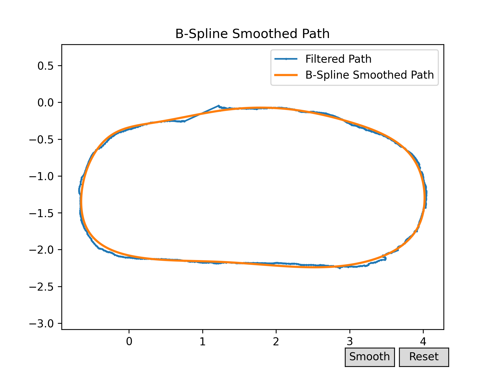

# f1Tenth

Install ROS2 Foxy, add this line to .bashrc

``` bash
source /opt/ros/foxy/setup.bash
```

## Make sure the odometry on the real car is tuned before running

## Mapping (need to be done on the real car)

### 1. Installing slam_toolbox

``` bash
sudo apt install ros-foxy-slam-toolbox
```

### 2. Running slam_tool_box

#### launch teleop

``` bash
ros2 launch f1tenth_stack bringup_launch.py
```

#### launch slam_toolbox

``` bash
ros2 launch slam_toolbox online_async_launch.py params_file:=src/f1tenth_system/f1tenth_stack/config/f1tenth_online_async.yaml
```

#### visualization

- Launch RViz

  ``` bash
  rviz2 
  ```

- Add /map by topic
- Add /graph_visualization by topic
- On top left corner of rviz, panels – add new panel – add SlamToolBoxPlugin panel
- Use the joystick to move the car for mapping. Once you’re done mapping, save the map using the plugin. You can give it a name in the text box next to Save Map. Map will be saved in whichever directory you ran slam_toolbox.

## Localization

### Simulator

#### 1. Map file

Make sure the map (.pgm and .yaml) you get via mapping are placed under src/f1tenth_gym_ros/maps

### Real car

#### 1. Map file

Make sure the map (.pgm and .yaml) you get via mapping are placed under src/particle_filter/maps and it is referenced in the config file.

#### 2. Installing range_libc

``` bash
git clone https://github.com/f1tenth/range_libc.git
cd range_libc/pywrapper
sudo WITH_CUDA=ON python setup.py install
```

#### 3. Run particle filter and log waypoints

``` bash
ros2 launch particle_filter localize_launch.py
```

``` bash
python waypoint_logger_node.py
```

- To observe localization and waypoint generation, launch RViz and add /map via topics. In the settings for map, change durability policy under topic to "transient local"
- To show the current localization, add /pf/viz/inferred_pose
- Optionally, you can add /pf/viz/particles to see the particles

#### 4. Process waypoints

1. Manually remove redundant and overlapping points, especially at the beginning or the end of the recording. These points could interfere with the following processes.
2. Create a smooth path by executing the following command and click on "Smooth". The smoothed path is saved next to the original file with a "smoothed" suffix.
    ``` bash
    python path_smoothing.py <path>/<filename>.csv
    ```
    

#### 5. Uniform arc length sampling
Edit input file in uniform_sampling_based_on_arc_length.py and execute. The output will be the waypoint file for the trajectory planning node.
```
cd ~/f1Tenth/src/trajectory_planning
python -m trajectory_planning.uniform_sampling_based_on_arc_length
```

## Trajectory planning node

The waypoint file used by the trajectory planning node should match the corresponding vref (for Pure Pursuit)/vref, T,
N (for MPC).

| Parameter     | Value            |
|---------------|------------------|
| waypoint_file | <YOUR_FILE_HERE> |

## Safety Node

### 1. Parameters

| Parameter     | Value           |
|---------------|-----------------|
| is_real_car   | True/False      |
| ttc_threshold | <TUNING_NEEDED> |
| fov_half      | <TUNING_NEEDED> |
| range_margin  | <TUNING_NEEDED> |

### 2. Use joystick to release braking (now only for the real car)

#### (1) change in f1tenth_system/f1tenth_stack/config/mux.yaml

ackerman_mux select between the topics /drive and /teleop based on their priority values. In the safety node, I want to use /drive to brake the car and ensure that the joystick /teleop doesn't cause the car to move when it is stopped. Therefore, /drive should have a higher priority.

#### (2) change in f1tenth_system/teleop_tools/joy_teleop/joy_teleop.py

Use buttons 4 (L1) and 1 (Circle) to release the car from braking status.

### Simulator

``` bash
ros2 launch f1tenth_gym_ros gym_bridge_launch.py
ros2 run safety_node safety_node
```

### Real car

``` bash
ros2 launch f1tenth_stack bringup_launch.py
ros2 run safety_node safety_node
```

## Pure Pursuit

### 1. Parameters

#### in pure_pursuit_node.py

| Parameter                | Value            |
|--------------------------|------------------|
| is_real_car              | True/False       |
| is_work_with_safety_node | True/False       |
| config_file              | <YOUR_FILE_HERE> |
| is_tracking_log          | True/False       |

#### in config.yaml

The waypoint file used by the trajectory planning node should match the corresponding vref.

| Parameter      | Value            |
|----------------|------------------|
| l_wheelbase    |                  |
| vref           |                  |
| lookahead_dist | <TUNNING_NEEDED> |

### 2. Simulator

see sim_pure_pursuit.bash

``` bash
ros2 launch f1tenth_gym_ros gym_bridge_launch.py
ros2 run trajectory_planning trajectory_planning_node
ros2 run safety_node safety_node
ros2 run pure_pursuit pure_pursuit_node
```

### 3. Real car

see real_car_pure_pursuit.bash

``` bash
ros2 launch f1tenth_stack bringup_launch.py
ros2 launch particle_filter localize_launch.py
rviz2
ros2 run trajectory_planning trajectory_planning_node
ros2 run safety_node safety_node --ros-args -p is_real_car:=true
ros2 run pure_pursuit pure_pursuit_node --ros-args -p is_real_car:=true
```

## MPC

### 1. Parameter

#### in mpc_node.py

| Parameter                | Value            |
|--------------------------|------------------|
| is_real_car              | True/False       |
| is_work_with_safety_node | True/False       |
| config_file              | <YOUR_FILE_HERE> |
| is_tracking_log          | True/False       |

#### in config.yaml

The waypoint file used by the trajectory planning node should match the corresponding vref, T, N.

| Parameter  | Value                                                     |
|------------|-----------------------------------------------------------|
| L          |                                                           |
| vref       |                                                           |
| Tf         |                                                           |
| N          |                                                           |
| model_type | model_input_accel_steering/model_input_accel_steeringrate |
| Q          |                                                           |
| R          | <TUNING_NEEDED>                                           |
| Q_e        |                                                           |
| u_min      |                                                           |
| u_max      |                                                           |
| x_min      |                                                           |
| x_max      |                                                           |

### 2. Simulator

see sim_mpc.bash

``` bash
ros2 launch f1tenth_gym_ros gym_bridge_launch.py
ros2 run trajectory_planning trajectory_planning_node
ros2 run safety_node safety_node
ros2 run mpc mpc_node
```

### 3. Real car

see real_car_mpc.bash

``` bash
ros2 launch f1tenth_stack bringup_launch.py
ros2 launch particle_filter localize_launch.py
rviz2
ros2 run trajectory_planning trajectory_planning_node
ros2 run safety_node safety_node --ros-args -p is_real_car:=true
ros2 run mpc mpc_node --ros-args -p is_real_car:=true
```

## Parameter Tuning

See parameter_tuning_pure_pursuit.py, parameter_tuning_mpc.py

``` bash
python3 parameter_tuning_pure_pursuit.py
python3 parameter_tuning_mpc.py
```
